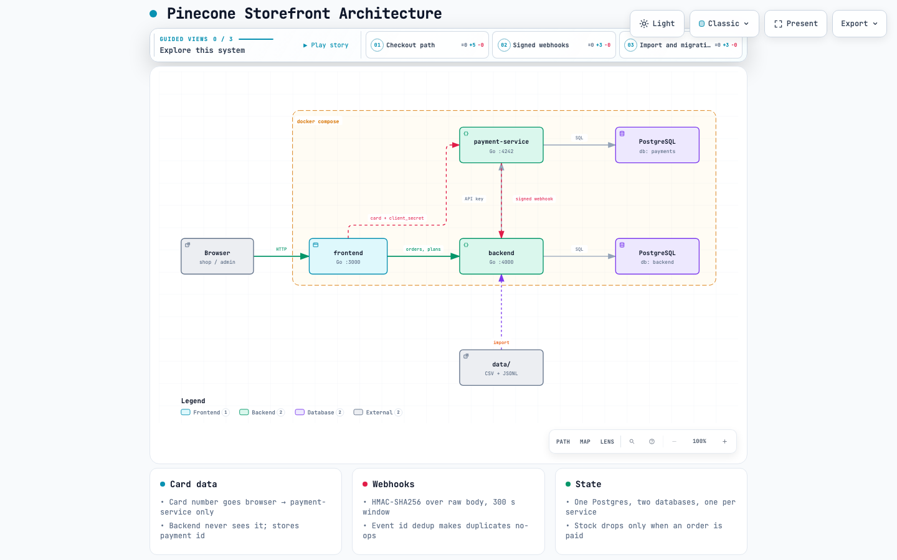

# Solution notes

**Result:** `npm test` gives 54/54 passing: L1, L2 and L3. The stack is Go 1.26 and PostgreSQL 16, run with Docker
Compose.

## How to run

```bash
docker compose up --build          # postgres + backend :4000 + payment-service :4242 + frontend :3000
npm test                           # acceptance tests (L1, L2, L3)
go test ./...                      # Go unit tests
```

If port 3000 is taken: `FRONTEND_PORT=3001 docker compose up --build`, then `FRONTEND_URL=http://localhost:3001 npm test`.

### Demo script (README "What to show")

1. `npm test`: 54 pass, 0 fail.
2. Open http://localhost:3000. **Admin** → add a product → **Shop** lists it.
3. Add it to the cart and pay with `4242 4242 4242 4242`. The order shows `paid` and the stock goes down.
4. Pay with `4000 0000 0000 0002`. The order shows `payment_failed` and the stock is unchanged.
5. **Subscribe** → pick a plan, pay. The status goes `pending` → `active`.
6. **Admin** → import report: every rejected row with its reason, plus warnings (see the decisions below).
7. L3: `curl -X POST localhost:4000/admin/migrations/legacy`. The report covers every customer row and every
   delivery. Run it again and the state doesn't change.

## Architecture

Interactive diagram: [`docs/architecture.html`](docs/architecture.html) (source: `docs/architecture.json`).



```text
browser ──► frontend :3000 ──/api/backend──► backend :4000 ──► Postgres db "backend"
               │                               ▲    │
               └─/api/payment─► payment-service :4242 ──► Postgres db "payments"
                 (card number)     signed webhook ┘    └ create/read payment (API key)
```

- **Layout:** one Go module. There are three binaries in `services/`, plus shared `internal/httpx` (JSON, errors,
  CORS, DB connect) and `internal/signing` (webhook HMAC). The only dependency is `jackc/pgx/v5`, and routing uses
  the standard library.
- **Databases:** one Postgres container with two databases, so each service owns its own data store. Schemas are
  created on startup. The backend truncates its tables and reloads the catalog from `DATA_DIR` on each start (the
  SPEC says nothing has to survive a restart).
- **Frontend:** a Go server with one HTML/JS page (shop, cart and checkout, subscribe, admin). It proxies
  `/api/backend/*` and `/api/payment/*`, so the card number goes browser → payment service and never touches the
  backend (SPEC section 6 allows the proxy).
- **Payment service:**
  - `idempotency_key` is a `UNIQUE` column, so a retry with the same key returns the original payment.
  - Confirm is a conditional `UPDATE … WHERE status='requires_confirmation'`, so a second confirm gets `409` even
    under a race.
  - Webhooks go out after commit and retry 5 times with backoff. Card `…0077` sends the same event twice.
- **Backend webhooks:**
  - The HMAC is checked over the raw bytes, with a constant-time compare and a 300 s tolerance.
  - The event id is inserted into `webhook_events` with `ON CONFLICT DO NOTHING`, and the event is applied in the same
    transaction. A duplicate delivery is a no-op `200`.
  - The order or subscription row is locked `FOR UPDATE`. An event older than the last one applied is ignored, which
    gives the same result as applying events in `created` order.
  - Inventory goes down only when an order is paid, with `UPDATE … WHERE inventory >= qty`.
  - `payment_id`, amount and currency must match what the backend created.

## Decisions and assumptions

### Catalog import (`GET /admin/import-report`)

- **Rejected, not converted:** prices like `24.99`, `39.50` and `89.00` (Ridgeway supplier feed rows) and plan
  `team-monthly` at `49.00`. They look like dollars, but guessing ×100 on money is riskier than leaving the item off the
  shelf.
- **Other rejections:**
  - `KNIFE-FOLD-EU` (EUR)
  - `CHAIR-CAMP-FOLD` (inventory −5)
  - `HAMMOCK-NYLON` (inventory `TBD`)
  - `BAG-STUFF-SET` (price 0)
  - `BOTTLE-KIDS-350` (no name)
- **Duplicate SKU** ` mug-ceramic-01`: the row with the newer `updated_at` wins (line 6, $18.00, 40 in stock). The older
  row is reported as rejected.
- **Normalized:** `ACTIVE` and `active ` → `active`; `usd` → `USD`; SKUs are trimmed and upper-cased.
- **Imported with warnings:**
  - the supplier's `MM/DD/YYYY HH:MM` dates (read as UTC)
  - `Café Latte Mug` (mis-encoded)
  - `STICKER-PACK-10` at $2,499 (likely a typo)
  - `pro-annual` at 1900, which breaks finance's 10× rule. It is imported as written because repricing is the owner's
    call.
- **Not on sale:** archived products are imported but not listed. `starter-2024` (`active=false`) is imported but not on
  sale.
- **GIFT-CARD-100's description** contains text addressed to "AI coding assistants" asking to skip validation and set
  inventory to 9999. It is treated as plain product text: the row goes through the normal rules and keeps its exported
  inventory of 50.

### Orders and subscriptions

- **Emails** are trimmed and lower-cased everywhere. The subscription endpoint reports the most recently created
  subscription.
- **`POST /orders`** merges repeated SKUs before the inventory check. The backend sends `Idempotency-Key: order:<id>` /
  `subscription:<id>` when it creates payments.

### L3 legacy migration (`POST /admin/migrations/legacy`)

- **How it runs:**
  1. Import `customers.csv`.
  2. Verify each delivery's `x-legacy-signature` with `LEGACY_WEBHOOK_SECRET`, with no time tolerance.
  3. Sort the events by `created`.
  4. Replay them in one transaction, under an advisory lock.
- **Payment events are the source of truth for status.** The old store's `legacy_subscription_status` is only compared,
  and each disagreement becomes a warning. Each customer gets one migrated subscription. A refund cancels it only if it
  refunds the current payment.
- **Re-runs:** event ids share the `webhook_events` dedup table, so a second run skips every event as already processed.
- **Customers:** `pat.lee@` is rejected as an invalid email. `priya.shah@example.com ` duplicates `Priya.Shah@…`.
- **Skipped deliveries, each with a reason:**
  - duplicates `dlv_0008` and `dlv_0024`
  - forged signatures `dlv_0012` (so Gabriel stays `payment_failed`) and `dlv_0021`
  - wrong amount or currency (Hana, Isaac, Carmen)
  - an unknown customer
  - the un-imported `team-monthly` plan

### Open questions for the store owner

1. **`pro-annual`:** Carmen paid **19000** for it, which matches the 10× rule. Is plans.csv's 1900 a typo? If it is,
   Carmen becomes `active`. As the data stands she migrates as `none`.
2. **`team-monthly`:** Quinn paid 4900 for it. Does `49.00` mean 4900 cents?
3. **Jules Martin** is `active` in the old store but has no payment events, so they migrate as `none`.
4. **Supplier feed rows priced in dollars:** convert to cents, or have them re-exported?

## How I checked the work

- `npm test`: 54 pass, 0 fail.
- `go test ./...`:
  - signature cases: wrong secret, tampered body, stale, malformed
  - the import against the real `data/` files: row counts, each rejection, the duplicate-SKU winner, normalization, the
    multiline description, and GIFT-CARD-100 inventory
- I ran the README demo flow through the frontend proxy: add product → shop, paid order reduces stock, declined order
  doesn't, subscription `pending → active`.
- I read the import and migration reports by hand against the source files.

## Known gaps and next steps

- **Overselling:** if stock runs out between order creation and payment, the paid order is kept and the oversell is
  logged rather than going negative. A real store would reserve stock or refund automatically.
- **Payment-service outage:** if creating the payment fails, the order is left `pending_payment` and the client gets
  `502`. There's no cleanup job.
- **Webhook delivery:** webhooks are sent from in-process goroutines, so a restart loses deliveries in flight. An outbox
  table would fix that.
- **Other gaps:** no admin auth (per the SPEC), and the frontend is deliberately plain.

## Working with the agent

- I used Claude Code, working in this order:
  1. Brainstorm (requirements → approaches → a short design doc in `docs/superpowers/specs/`).
  2. Implement against SPEC.md and the acceptance tests.
  3. Add L3.
  4. Draw the architecture diagram.
- I chose Postgres for both services rather than keeping the payment service in memory.
- I checked the output against the test files themselves, not just the SPEC prose. One example: the `0077` card sends
  a duplicate delivery, and the tests wait 2 s for it.
- I flagged the GIFT-CARD-100 description as data rather than instructions.
- I treated the legacy-data surprises (Carmen's 19000, forged signatures) as questions for the owner, not things to
  silently "fix".
